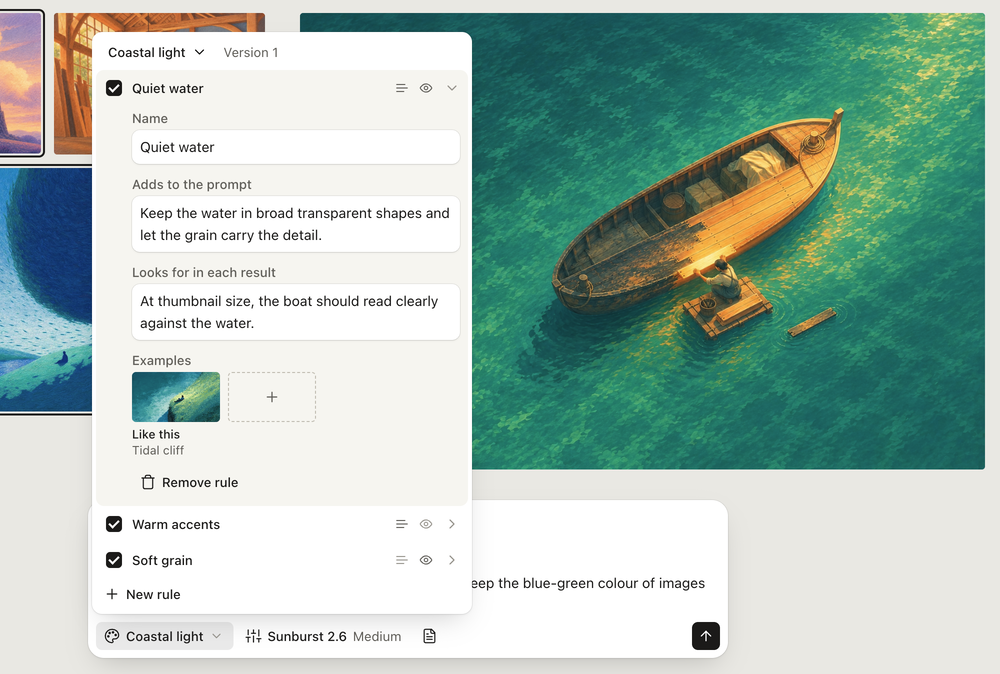
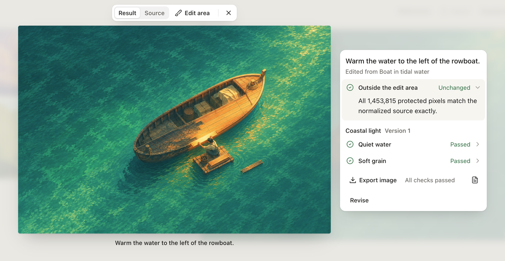

# Charcoal

Charcoal is a local workspace for editorial illustration. Arrange references on a freeform canvas, attach them to a prompt, and keep the results alongside your work.


## Run it on a Mac

Use Node 24.22.1, npm 11.19.1, and ImageMagick 7 with `magick` on your PATH.

```sh
npm ci
npm run build
npm start
```

Open [Charcoal](http://127.0.0.1:4317/). To generate illustrations and run visual checks, set `OPENAI_API_KEY` in the server environment or an ignored `.env` file in the repository root, then restart.

Boards and images are stored locally in `.charcoal/studio`. The local service sends your prompt, selected images, and any review materials to OpenAI. More variations increase generation cost, and enabled style checks make additional requests for each result.

## Edit part of an image

Choose **Edit area** and paint over the subject you want to change, including nearby contours that need to move with it. Changes fade into the surrounding illustration. Charcoal checks that pixels beyond the blend match the source exactly. Use **Annotate** to guide wider revisions.


## Save a style

Keep reusable prompt instructions, visual checks, and example images together. Each run records the version of the style it used.



## Review and export

Switch between the source and the result, inspect the checks, then keep and export a PNG or start a revision.



The screenshots use a local walkthrough with a staged result and scripted style checks.

`npm test` runs the unit suite. `npm run test:browser` exercises the app in Chrome with a local fixture provider.
